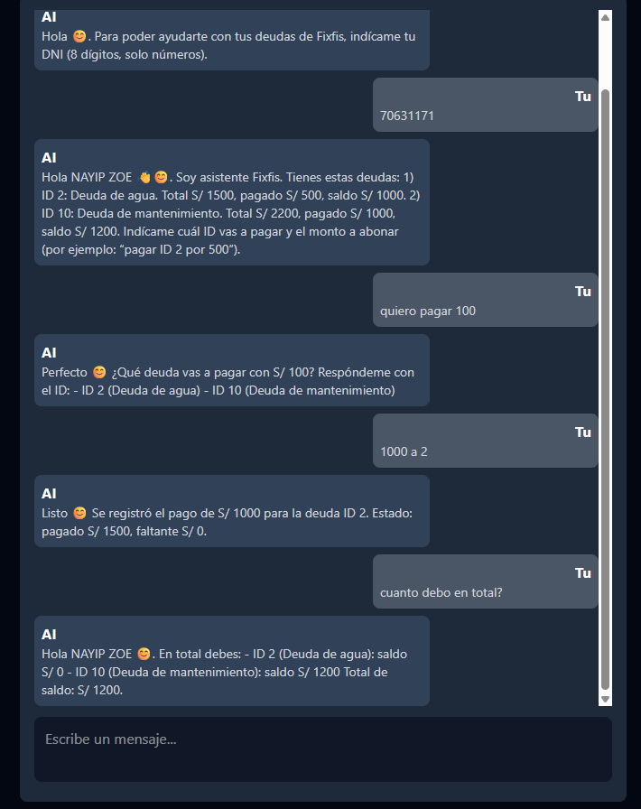
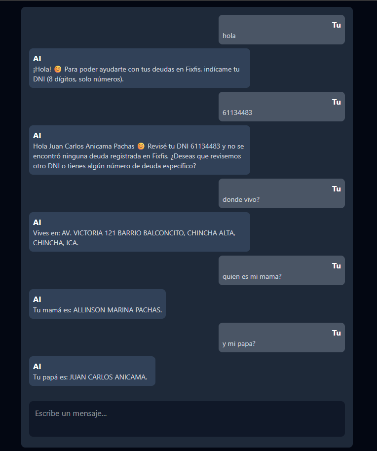
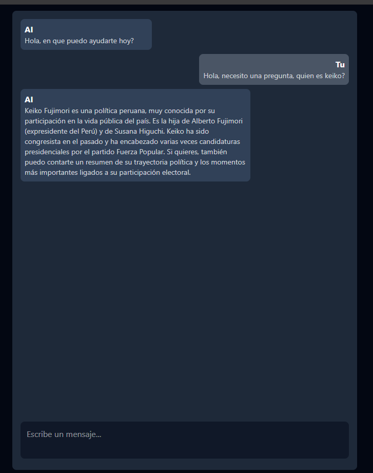
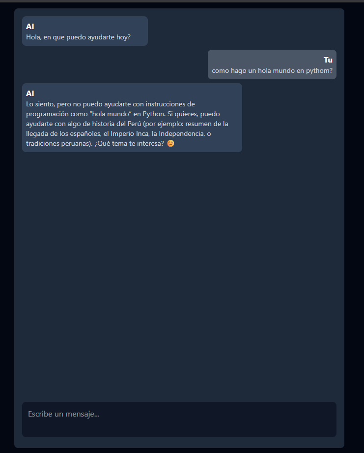

# Proyecto hecho en react.

## Deudas

>En la imagen se aprecia un pago de una deuda

>En la iamgen se aprecia la consulta a reniec del usuario atraves de su dni

## Historia

>Se puede apreciar que el chatbot tiene conocimientos del campo

>Se aprecia que el chatbot rechaza cualquier tema NO relacionado con historia del peru o general
